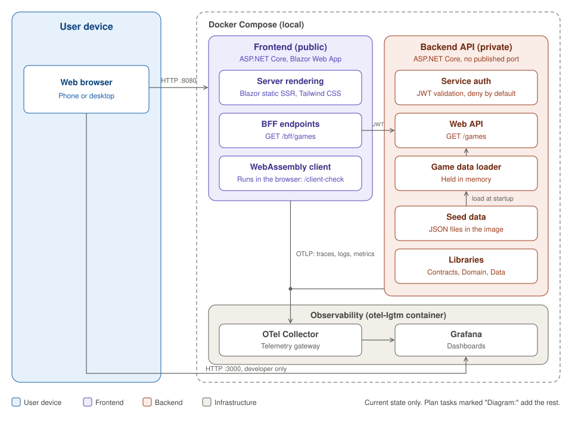
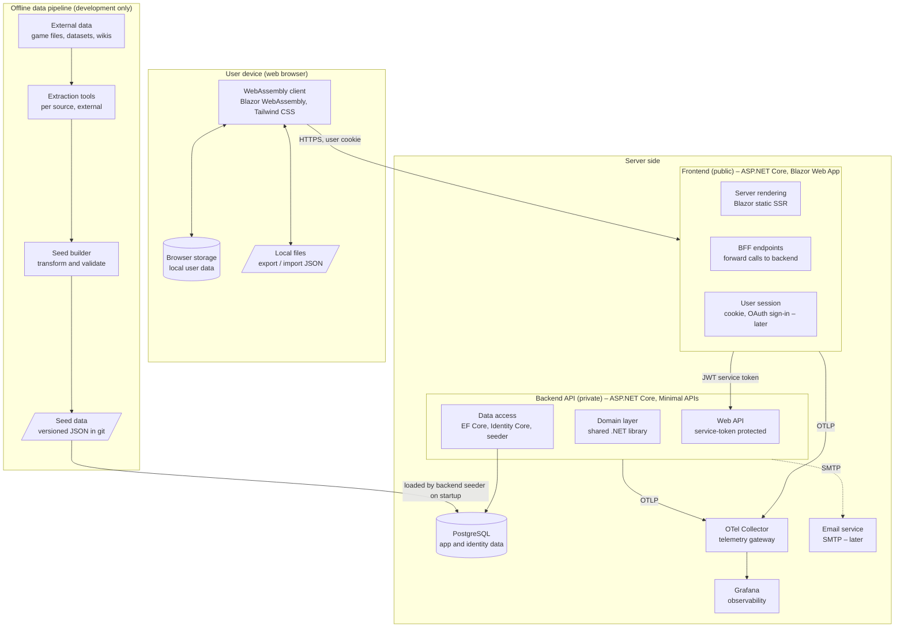

# 03 – Architecture

## Overview



- Image: [`images/architecture.svg`](images/architecture.svg) (PNG copy: [`images/architecture.png`](images/architecture.png)).
- The diagram shows **infrastructure only** (no app features, game-specific tools or environment-specific products).
- The Mermaid version below is the editable source. Keep both in sync when the architecture changes.

### Implementation per environment

| Component | Local (development) | Production |
|---|---|---|
| Frontend, backend | Docker Compose containers | Container host decided in Phase 6 |
| Private network | Docker Compose network (backend not published) | Internal-only ingress / private network |
| PostgreSQL | `postgres` container | Decided in Phase 6 (e.g. Neon, Azure Flexible Server, self-hosted) |
| OpenTelemetry Collector | Built into the `grafana/otel-lgtm` container (OTLP 4317/4318) | Collector container on the private network (e.g. Grafana Alloy) |
| Grafana | `grafana/otel-lgtm` container (UI 3000) | Grafana Cloud Free |
| Email service | Mailpit container (Phase 5) | Email provider, decided in Phase 6 |
| Frontend cookie keys (Data Protection) | Docker volume | Key store decided in Phase 6 |

### Mermaid source



## Key ideas

- **Frontend and backend are separate services.**
  - **Frontend (public):** the only thing users reach. Serves pages and the WebAssembly client, runs OAuth handshakes, issues the session cookie, and exposes BFF (Backend-for-Frontend) endpoints. **No database, no SMTP.**
  - **Backend API (private):** owns all data (game data, progress, user accounts), business rules and outbound email. Not reachable from the internet. Accepts only service-authenticated calls.
- **Two kinds of access:**

| Caller → callee | Identity | Mechanism |
|---|---|---|
| Browser → frontend | **User account** (or anonymous guest) | HTTPS, Identity cookie (Phase 5), antiforgery |
| Frontend → backend | **Service account** (frontend) + acting user ID | JWT bearer service token |

- **The WebAssembly client never calls the backend and never holds secrets.** Code in the browser is public.
- **Secrets live where they are needed, and nowhere else:** provider OAuth secrets and cookie keys in the frontend; database, SMTP credentials and service-token validation keys in the backend; Grafana credentials in the Collector.
- **Game data flows one way:** external data → extraction tools → seed builder → JSON in git → database (loaded by the backend seeder). Never edited at runtime.
- **Guest progress lives in the browser.** The server is not involved until the user signs in.
- **Domain logic is shared.** The same C# library runs in the backend and in the WebAssembly client (for instant local calculations).
- **Telemetry** from both services goes through OpenTelemetry to a **Collector on the private network**. Only the Collector talks to Grafana and holds its credentials. One trace spans browser request → frontend → backend.
- **Browser errors** (WebAssembly client) go to a rate-limited frontend BFF endpoint, never directly to the Collector or Grafana.

## Service authentication (frontend → backend)

- **Token:** JWT, signed by the frontend with its private key (ES256). The backend validates it with the frontend's public key.
- **Claims:**
  - `iss` = `companion-frontend`, `aud` = `companion-backend`.
  - `exp` ≤ 5 minutes. Tokens are cached and refreshed by the frontend.
  - `scope`, e.g. `game-data.read`, `progress.read`, `progress.write`, `auth` (account operations).
  - `uid` = opaque user ID, **only** when acting for a signed-in user.
- **Rules:**
  - The backend takes the user ID **only** from the `uid` claim, never from the URL, query or body.
  - Keys come from secrets (`dotnet user-secrets` / `.env` locally, a secret store in production). Never in git.
  - Defense in depth: the backend is also unreachable from outside (private network).
- **Production option (Phase 6):** if hosted on Azure, the token can come from Microsoft Entra ID (managed identity) instead of self-signed keys. The backend only changes its token validation settings.

## Request flows

### Page load (public page)

1. Browser → frontend: request a page.
2. Frontend → backend (service token, no `uid`): get game data.
3. Frontend renders HTML (static SSR). Public game data can be output-cached in the frontend.

### Guest uses an interactive page

1. WebAssembly client → frontend BFF: get game data (anonymous).
2. Frontend → backend (service token): forward.
3. User changes are saved in browser storage. Calculations run locally. No server call.

### Browser error reporting

1. WebAssembly client catches an unhandled error.
2. Client → frontend `POST /bff/client-errors` (anonymous allowed, rate-limited, size-limited, no personal data).
3. Frontend logs it through its OpenTelemetry pipeline → Collector → Grafana.

### Export / import

1. Export: browser state → JSON file download.
2. Import: file → validate → migrate old format → replace or merge → browser storage.
   (Signed-in users: then synced through the BFF.)

### Sign-in (Phase 5)

1. External: frontend completes the OAuth handshake → backend `POST /auth/external-login` → backend returns `uid`.
2. Email/password: frontend form → backend `POST /auth/password-sign-in` → backend verifies → returns `uid`.
3. Frontend issues the session cookie with `uid`.
4. Details: [08-identity-and-accounts.md](08-identity-and-accounts.md).

### Signed-in sync (Phase 5)

1. Change saved locally first.
2. WebAssembly client → frontend BFF `POST /bff/progress/...` with Identity cookie and antiforgery token.
3. Frontend reads the user ID from the cookie session and calls the backend with a service token carrying `uid`.
4. Backend merges (last-write-wins per item, by `UpdatedAt`).

## Data ownership

| Data | Owner | Store |
|---|---|---|
| Game data (seeded) | Backend | PostgreSQL `companion`, schema `app` |
| User progress (signed in) | Backend, keyed by opaque user ID | PostgreSQL `companion`, schema `app` |
| User accounts, logins, password hashes, email tokens | Backend (Identity Core) | PostgreSQL `companion`, schema `identity` |
| Session cookie keys | Frontend | Data Protection key storage (volume / key store) |
| Guest progress | User | Browser storage, export files |

- **Only the backend connects to PostgreSQL.** One database `companion`, schemas `app` and `identity`.
- Database users: a runtime user (data read/write) and a migrations user (schema owner).
- Provider access tokens are not stored. Email addresses exist only in the `identity` schema and are never logged.

## Solution structure (planned)

```
UniversalCompanionApp/
├─ src/
│  ├─ Companion.Domain/              Pure domain logic. No EF/ASP.NET references.
│  ├─ Companion.Contracts/           DTOs and API contracts shared by frontend and backend.
│  ├─ Companion.Frontend/            Public host: static SSR, BFF endpoints, cookie + OAuth sign-in (Phase 5).
│  ├─ Companion.Frontend.Client/     Blazor WebAssembly project (interactive UI).
│  ├─ Companion.Backend.Api/         Private host: Minimal APIs, service-token auth, auth endpoints, email.
│  └─ Companion.Backend.Data/        EF Core DbContexts (app, identity), migrations, seeder.
├─ tools/
│  └─ Companion.SeedBuilder/         External data → validated seed JSON.
├─ data/
│  ├─ schema/                        JSON Schemas for seed files and export format.
│  └─ games/<game>/                  Seed data per game.
├─ tests/
│  ├─ Companion.Domain.Tests/
│  ├─ Companion.Backend.Tests/       API + data (Testcontainers).
│  ├─ Companion.Frontend.Tests/      bUnit + BFF tests.
│  ├─ Companion.Architecture.Tests/
│  └─ Companion.E2E/                 Playwright.
├─ docs/
├─ docker-compose.yml
├─ src/Companion.Frontend/Dockerfile
├─ src/Companion.Backend.Api/Dockerfile
├─ Companion.slnx
├─ Directory.Build.props
├─ Directory.Packages.props
└─ CLAUDE.md
```

## Dependency rules

```
Frontend.Client ──► Domain, Contracts
Frontend ──► Frontend.Client, Contracts, Domain
Backend.Api ──► Backend.Data ──► Domain
Backend.Api ──► Contracts
Domain, Contracts ──► (nothing)
```

- **Frontend projects never reference Backend projects, and the reverse.** They only share `Domain` and `Contracts`.
- The frontend talks to the backend only over HTTP (typed `HttpClient`).
- Enforced by `Companion.Architecture.Tests`.
- Why these projects, and which structures were rejected: [ADR 0012](adr/0012-project-structure.md).

## Docker Compose services

| Service | Image | Published ports | Network | Phase |
|---|---|---|---|---|
| `frontend` | built from `src/Companion.Frontend/Dockerfile` | 8080 (HTTP), 8081 (HTTPS) | public + internal (reaches `backend` and the Collector only) | 0 |
| `backend` | built from `src/Companion.Backend.Api/Dockerfile` | **none** (optional localhost-only port in `docker-compose.override.yml` for debugging) | internal only | 0 |
| `postgres` | `postgres:<pinned>` | 5432 (localhost only, for dev tools) | backend network only | 0 |
| `otel-lgtm` | `grafana/otel-lgtm:<pinned>` (Collector + Grafana) | 3000 (Grafana UI, localhost only) | internal | 0 |
| `mailpit` | `axllent/mailpit:<pinned>` | 8025 (UI) | backend network only | 5 |
